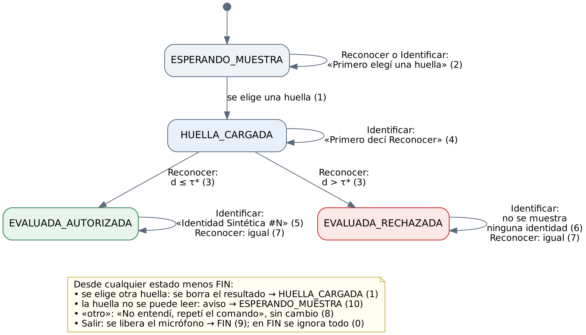
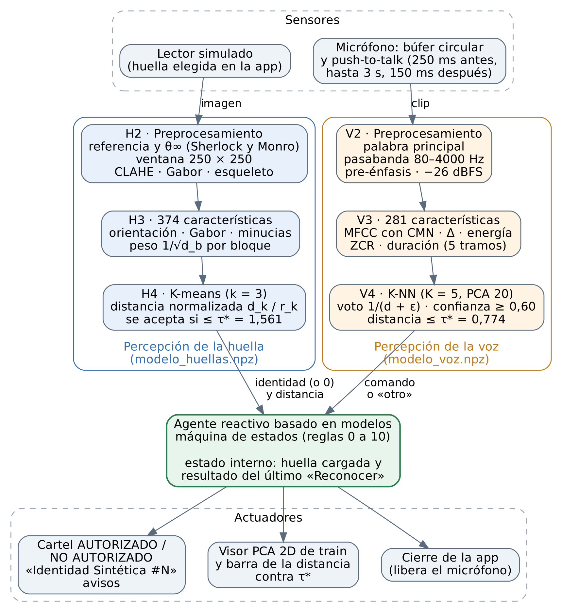
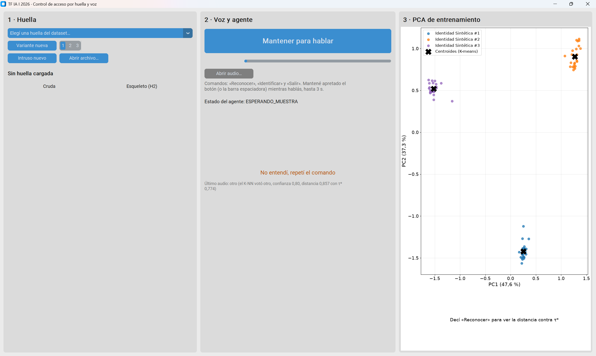
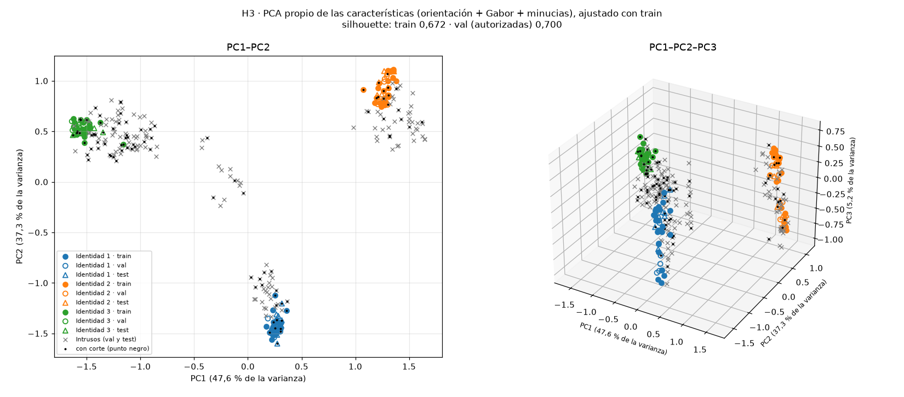
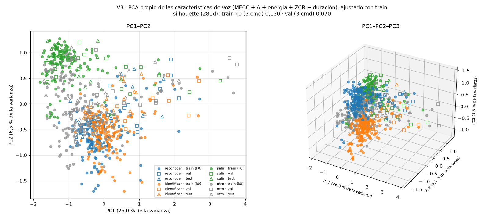
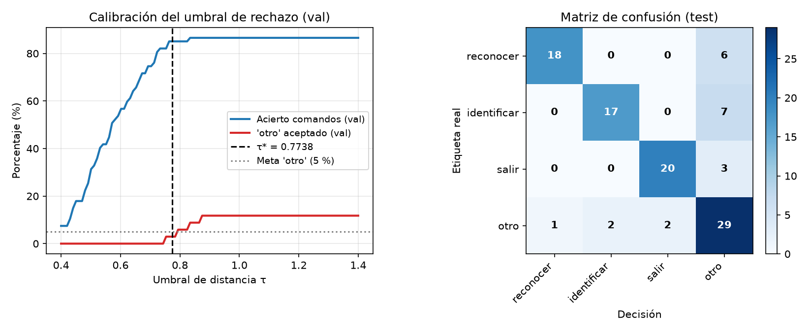

<!--
Borrador del informe final (Fase 6). Se arma con pandoc a Word y de ahí a PDF (ver docs/informe/LEEME.md).
Lo que está entre corchetes lo completa Santiago. Los números salen del Documento 2 v0.7.5,
de los contratos de cada etapa y de lo que imprimen los módulos; si se regenera algo, se actualizan acá.
-->

# Resumen

Se desarrolló un agente de control de acceso que decide si una huella dactilar sintética pertenece a una de tres identidades autorizadas y se maneja con los comandos de voz «Reconocer», «Identificar» y «Salir». Las huellas se generan con un modelo propio (campo de orientación y filtrado de Gabor iterativo), con variantes de rotación, traslación, presión, cortes y ruido, e intrusos. Cada huella se alinea, se realza y se describe con 374 características de orientación, textura de Gabor y minucias. Un K-means propio (k = 3) da los centroides y una distancia normalizada, con un umbral calibrado en validación, decide la aceptación. Los comandos se describen con MFCC, energía, cruces por cero y duración, y los clasifica un K-NN propio que rechaza lo que no es comando. PCA, K-means y K-NN se programaron desde cero con NumPy. En test, las huellas dan identificación del 100 %, FAR 0 % y FRR 4,2 %. La voz acepta el 77,5 % de los comandos de cuatro personas nuevas, por debajo de la meta del 90 %; en vivo, con otras tres, el 91,2 %. El agente funciona completo; falta rechazar mejor palabras parecidas a los comandos.

# 1. Introducción

**Visión artificial.** La visión artificial extrae información de imágenes para tomar decisiones: primero se acondiciona la imagen (ruido, contraste, segmentación del objeto de interés), después se miden propiedades que describen lo que importa y, con esas medidas, se clasifica. En una huella dactilar lo que importa es el patrón de crestas: el campo de orientación, las singularidades (núcleos y deltas, que definen el tipo de huella: presilla, verticilo, arco en tienda o arco) y las minucias, es decir, las terminaciones y bifurcaciones de las crestas, que distinguen una huella de otra del mismo tipo (Maltoni et al., 2022).

**Reconocimiento de voz.** El reconocimiento de voz convierte una señal acústica en una etiqueta: se detecta y recorta la palabra, se describe cada tramo corto de la señal con características que imitan cómo el oído reparte la energía en frecuencia (los coeficientes cepstrales en escala mel, MFCC; Davis y Mermelstein, 1980) y un clasificador decide. Acá alcanza con un vocabulario cerrado de tres palabras dichas de a una, pero el sistema tiene que funcionar con cualquier hablante, también con los profesores en la demo, y rechazar lo que no es un comando (otras palabras, ruido o silencio).

**El problema.** El enunciado plantea un control de acceso sin datos biométricos de personas reales. Se generan 3 identidades autorizadas sintéticas, variantes de cada una que simulan capturas reales (traslación, rotación, ruido gaussiano y de sal y pimienta, presión y cortes parciales) y un lote de huellas intrusas. Ante una huella nueva, el agente decide si pertenece a una identidad autorizada (K-means con k = 3 y un umbral de distancia justificado experimentalmente) y, si es así, a cuál. El agente se controla con tres comandos de voz reconocidos con K-NN: «Reconocer» muestra AUTORIZADO o NO AUTORIZADO, «Identificar» muestra «Identidad Sintética #N» solo si la huella fue autorizada y «Salir» termina la ejecución.

**Lo que se hizo.** Se programó en Python 3.12 un sistema con dos cadenas de percepción y un agente que las coordina. La de huellas genera las imágenes (etapa H1), las alinea y realza (H2), las describe con un vector de características (H3) y las clasifica con K-means y un umbral (H4). La de voz arma un dataset con grabaciones de 26 personas (V1), preprocesa cada clip (V2), extrae características acústicas (V3) y las clasifica con K-NN y un umbral de rechazo (V4). La Fase 5 integra todo en una aplicación de escritorio con push-to-talk. PCA, K-means, K-NN, la silhouette y la matriz de confusión se programaron desde cero con NumPy; scikit-learn se usó solo en los tests, para comparar resultados.

El informe sigue el orden de la consigna: especificación del agente (sección 2), diseño de cada etapa (3), código (4), ejemplos de la aplicación (5), resultados con los datos, el PCA y las estadísticas de clasificación (6), conclusiones (7), bibliografía (8) y uso de IA generativa (9).

# 2. Especificación del agente

## 2.1 Tipo de agente

Es un **agente reactivo basado en modelos** (Russell y Norvig, cap. 2). Elige cada acción con reglas condición–acción, como un reactivo simple, pero la condición depende también de un estado interno: qué huella está cargada y, si ya se dijo «Reconocer», con qué resultado. Ese estado hace falta porque «Identificar» no se puede responder mirando solo el comando: la respuesta correcta depende de lo que dio la última evaluación de la huella que está cargada.

El modelo del agente tiene dos partes: cómo cambia el estado con cada percepción (cargar otra huella borra la evaluación anterior) y cómo se interpreta cada percepción (los modelos entrenados: K-NN para la voz; alineación, vector de características, K-means y umbral para la huella).

Por qué no otro tipo:

- **Reactivo simple:** ante el mismo comando («Identificar») la acción correcta cambia según lo que pasó antes.
- **Basado en objetivos o en utilidad:** no hay secuencias de acciones para planificar ni alternativas que comparar en cada paso. El umbral τ\* resume un compromiso entre falsos aceptados y falsos rechazados, pero se fija antes de operar, en validación, y no lo recalcula el agente.
- **Agente que aprende:** el aprendizaje (K-means, K-NN y umbrales) ocurre antes de usar el agente; en operación no hay crítico ni elemento de aprendizaje. Reentrenar con muestras nuevas queda como trabajo futuro.
- **Un agente o dos:** es un solo agente con dos sensores, porque hay un único estado y una única política que decide qué hacer con cada comando.

```text
función AGENTE-REACTIVO-BASADO-EN-MODELOS(percepción) devuelve una acción
    persistente: estado (huella cargada, resultado de la última evaluación)
                 reglas (tabla 3)
    estado ← ACTUALIZAR-ESTADO(estado, percepción)
    regla  ← REGLA-QUE-COINCIDE(estado, percepción, reglas)
    devolver regla.acción
```

## 2.2 Tabla REAS

Tabla 1. Rendimiento, entorno, actuadores y sensores del agente.

| | |
|----|-----------------|
| **Rendimiento** | Huellas autorizadas de test asignadas a la identidad correcta: ≥ 95 %. FAR (intrusos aceptados) ≤ 5 % y FRR (autorizadas no aceptadas con su identidad) ≤ 10 %. Comandos reconocidos con voces de personas que no están en el entrenamiento: ≥ 90 %. Ruido u otras palabras tomados como comando: ≤ 5 %. Nunca mostrar una identidad si la huella cargada no fue autorizada. Respuesta en menos de 1 s desde que se suelta el botón para hablar. Demo sin cierres inesperados (3 de 3). |
| **Entorno** | El operador, que elige la huella y aprieta el botón para hablar. Las personas que dicen los comandos: cualquier hablante, también los profesores. Las huellas sintéticas: 3 identidades autorizadas con variantes e intrusos. El ruido ambiente del aula. La notebook (micrófono, pantalla y archivos de huellas). |
| **Actuadores** | Pantalla: cartel AUTORIZADO / NO AUTORIZADO, «Identidad Sintética #N», avisos y estado del agente. Visor PCA con la huella evaluada y una barra con su distancia contra τ\*. Cierre de la aplicación. |
| **Sensores** | Micrófono de la notebook con push-to-talk (graba mientras se mantiene apretado, hasta 3 s). Lector de huellas simulado: la imagen elegida en la interfaz. Teclado y mouse: elección de la huella y botón (o barra espaciadora) para hablar. |

## 2.3 Propiedades del entorno

Tabla 2. Propiedades del entorno de trabajo.

| Propiedad | Valor | Por qué |
|---|----|---------|
| Observable | Parcialmente | La identidad real de la huella y la palabra que quiso decir la persona no se perciben: se infieren de señales con ruido, rotación, cortes y micrófonos distintos. |
| Determinista | Estocástico | La misma persona o el mismo dedo dan muestras distintas en cada intento, y lo que se percibe después no depende de lo que hizo el agente. |
| Episódico | Episódico (un episodio por huella) | Lo que se decidió con una huella no cambia las siguientes. Dentro del episodio hay una dependencia corta («Identificar» usa el resultado de «Reconocer») que resuelve el estado interno. |
| Estático | Semidinámico | El entorno no cambia mientras el agente decide (la muestra ya está capturada), pero el tiempo de respuesta es parte del rendimiento. |
| Discreto | Percepciones continuas; estados y acciones discretos | El audio y la imagen son señales continuas digitalizadas; el agente tiene 4 estados de trabajo (más el de fin) y un conjunto finito de acciones, y actúa por eventos. |
| Agentes | Individual | Las personas son parte del entorno. En un sistema real, un intruso que intenta engañar al lector sería un agente adversario; acá los intrusos son muestras sin estrategia. |
| Conocido | Conocido | Se sabe qué efecto tiene cada acción: mostrar un mensaje o cerrar la aplicación. |

## 2.4 Reglas condición–acción

El agente es una máquina de estados con cuatro estados de trabajo (ESPERANDO_MUESTRA, HUELLA_CARGADA, EVALUADA_AUTORIZADA y EVALUADA_RECHAZADA) y el estado FIN. Las reglas 1 a 9 se escribieron al empezar el trabajo; la 10 se agregó al integrar, para una huella que no se puede leer, y la 0 fija qué pasa después de «Salir».

Tabla 3. Reglas condición–acción.

| N.° | Estado | Percepción | Acción | Estado siguiente |
|--|---------|-------|-------------|---------|
| 1 | Cualquiera menos FIN | Se elige una huella | Mostrarla (cruda y esqueleto) y borrar el resultado anterior | HUELLA_CARGADA |
| 2 | ESPERANDO_MUESTRA | «Reconocer» o «Identificar» | «Primero elegí una huella» | ESPERANDO_MUESTRA |
| 3 | HUELLA_CARGADA | «Reconocer» | Evaluar la huella: cartel AUTORIZADO (verde) o NO AUTORIZADO (rojo) y punto en el PCA | EVALUADA_AUTORIZADA o EVALUADA_RECHAZADA |
| 4 | HUELLA_CARGADA | «Identificar» | «Primero decí Reconocer» | HUELLA_CARGADA |
| 5 | EVALUADA_AUTORIZADA | «Identificar» | Mostrar «Identidad Sintética #N» | EVALUADA_AUTORIZADA |
| 6 | EVALUADA_RECHAZADA | «Identificar» | «Huella no autorizada: no se muestra ninguna identidad» | EVALUADA_RECHAZADA |
| 7 | EVALUADA_AUTORIZADA o EVALUADA_RECHAZADA | «Reconocer» | Volver a evaluar la huella cargada (da el mismo resultado) | El mismo |
| 8 | Cualquiera menos FIN | Ruido u otra palabra | «No entendí, repetí el comando» | Sin cambio |
| 9 | Cualquiera menos FIN | «Salir» | Liberar el micrófono y cerrar la aplicación | FIN |
| 10 | Cualquiera menos FIN | Una huella que no se puede leer | «No se pudo leer la huella: elegí otra» y descartar la anterior | ESPERANDO_MUESTRA |
| 0 | FIN | Cualquiera | Nada | FIN |

La identidad solo sale por la regla 5. Las reglas 1 y 10 son las que impiden mostrar la identidad de una huella evaluada antes: al cambiar de huella, o al fallar la carga de una nueva, el resultado anterior se borra. La figura 1 muestra la misma tabla como diagrama de estados.

{width=16cm}

# 3. Diseño del agente

La figura 2 muestra la arquitectura: dos sensores, una cadena de percepción por sensor, el agente con su estado y los actuadores. Cada cadena usa un modelo entrenado antes de operar (`models/modelo_huellas.npz` y `models/modelo_voz.npz`), con los datos de la sección 6.

{width=14cm}

## 3.1 Preprocesamiento de la huella (H2)

El objetivo de H2 es que dos capturas del mismo dedo queden superpuestas: misma posición, mismo ángulo y crestas limpias. Todo se hace en escala de grises sobre imágenes de 400 × 320 px.

1. **Limpieza y segmentación.** Una mediana de 3 × 3 saca la sal y pimienta. La máscara de la huella se arma con la energía local de la imagen pasa-altos (umbral: 0,55 del percentil 95), que separa las crestas del fondo liso.
2. **Campo de orientación.** Con el tensor de estructura suavizado con una gaussiana (σ = 3 px para buscar singularidades y 5 px para el ajuste) se obtiene la orientación θ de las crestas en cada píxel y su coherencia (Bazen y Gerez, 2002).
3. **Singularidades.** El índice de Poincaré en un círculo de 6 px de radio alrededor de cada punto suma las variaciones de la orientación, llevadas a (−π/2, π/2]:
   $$P = \frac{1}{2\pi}\sum_{i} \Delta\theta_i,$$
   que vale +½ en un núcleo, −½ en un delta y 0 lejos de las singularidades. Se descartan las que quedan a menos de 24 px del borde de la máscara, donde el campo no es confiable.
4. **Ángulo para enderezar.** Se ajusta el modelo de Sherlock y Monro (1993) al campo observado, por mínimos cuadrados sobre (cos 2θ, sen 2θ) ponderados por la coherencia, con los núcleos detectados (que se pueden mover hasta 6 px) y tantos deltas libres como núcleos:
   $$2\theta(z) = 2\theta_\infty + \sum_{k} \arg(z - c_k) - \sum_{k} \arg(z - d_k).$$
   θ∞ es la orientación de las crestas lejos de las singularidades: no depende de dónde estén los deltas, que en una huella cortada pueden quedar afuera. Sin núcleos (arco), θ∞ es el promedio circular del campo.
5. **Punto de referencia y ventana.** El punto de referencia es el núcleo (en el verticilo, el punto medio de los dos núcleos; en el arco, el centro de la zona de mayor curvatura). Se recorta una ventana de 250 × 250 px centrada en él y girada por *a*~v~ = ((θ∞ + π/2) mod π) − π/2, el menor de los dos giros que dejan θ∞ horizontal, sin reescalar.
6. **Realce y esqueleto.** CLAHE (límite 2,0 en una grilla de 8 × 8; Zuiderveld, 1994) normaliza el contraste local; un filtro de Gabor orientado en cada píxel según θ (16 orientaciones, período de 9 px; Hong et al., 1998) refuerza las crestas y borra lo que no sigue su dirección; la binarización es el signo de esa respuesta y el esqueleto, de un píxel de ancho, sale con el método de Lee et al. (1994).

En el prototipo, sobre las 300 imágenes del dataset, el punto de referencia queda a 5,7 px o menos del real y el ángulo a 2,0° o menos; H2 tarda unos 0,11 s por imagen en la notebook. La figura 3 muestra el resultado.

{width=16cm}

## 3.2 Vector de características de la huella (H3)

Cada huella alineada se describe con tres bloques, que se eligieron midiendo en un prototipo cuánto separaba cada uno las identidades (silhouette):

- **Orientación (50 valores).** En una grilla de 5 × 5 sobre la ventana, la media de (cos 2θ, sen 2θ) en la parte con huella de cada celda. Se usa 2θ porque la orientación de una cresta es la misma con θ y con θ + π.
- **Textura de Gabor (300 valores).** 12 filtros de Gabor (6 orientaciones × períodos de 8 y 10 px), con
  $$g(x, y) = \exp\!\left(-\frac{x'^2 + y'^2}{2\sigma^2}\right)\cos\!\left(\frac{2\pi x'}{P}\right), \qquad \sigma = P/2,$$
  donde x′ es la coordenada a lo largo de la orientación del filtro. De cada respuesta se toma el desvío absoluto medio en 3 anillos (de 20 a 110 px del punto de referencia) × 8 sectores, como en el FingerCode de Jain et al. (2000), más la energía global de cada filtro.
- **Densidad de minucias (25 valores).** Sobre el esqueleto, el *crossing number* de cada píxel de cresta con sus 8 vecinos *p*~1~, …, *p*~8~ (con *p*~9~ = *p*~1~),
  $$CN = \tfrac{1}{2}\sum_{i=1}^{8} |p_i - p_{i+1}|,$$
  vale 1 en una terminación y 3 en una bifurcación. Se descartan las minucias falsas: a menos de 14 px del borde de la máscara (incluido el borde de un corte), espuelas de menos de 12 px, pares de terminaciones a menos de 10 px y de bifurcaciones a menos de 8 px, y ramas de menos de 20 px. Se cuentan densidades por cada 1000 px² de zona válida: 3 globales, terminaciones y bifurcaciones en 3 anillos y una grilla de 4 × 4.

Una celda, sector o anillo con menos del 50 % de huella (por un corte o el borde de la ventana) no se calcula: se imputa con la media de train. Cada columna se estandariza con la media *μ*~j~ y el desvío *s*~j~ de train, y cada bloque se divide por la raíz de su cantidad de columnas *d*~b~, para que ningún bloque domine la distancia por tener más columnas:
$$\tilde{x}_j = \frac{x_j - \mu_j}{s_j}\cdot\frac{1}{\sqrt{d_b}}.$$
Una celda de la grilla de minucias no tiene ningún valor en train y queda afuera: el vector final tiene **374 columnas**. Se probó sumar los momentos de Hu (Hu, 1962): separaban poco (silhouette 0,13 en train) y empeoraban el total, así que no se usan.

**PCA propio.** Para mirar la separación de clases se programó el análisis de componentes principales: con la matriz centrada de train *X*~c~,
$$\Sigma = \frac{1}{n-1} X_c^\top X_c = V \Lambda V^\top, \qquad \mathbf{z} = V_k^\top (\mathbf{x} - \boldsymbol{\mu}),$$
con los autovectores ordenados por autovalor (`numpy.linalg.eigh`) y un signo fijo para que el resultado sea reproducible. Coincide con scikit-learn hasta 1e-11. El PCA se usa para visualizar (sección 6.3) y en la voz, para reducir la dimensión antes del K-NN; el K-means de las huellas trabaja con las 374 columnas.

## 3.3 K-means y umbral de aceptación (H4)

**K-means propio.** Con las 72 huellas de train, el K-means con k = 3 minimiza la inercia
$$J = \sum_{j=1}^{3} \sum_{\mathbf{x} \in C_j} \lVert \mathbf{x} - \mathbf{c}_j \rVert^2$$
con el algoritmo de Lloyd (1982): asignar cada punto al centroide más cercano y mover cada centroide a la media de su grupo, hasta que los centroides se muevan menos de 1e-4. Los centroides iniciales salen de k-means++ (Arthur y Vassilvitskii, 2007), que elige cada uno con probabilidad proporcional al cuadrado de la distancia al más cercano ya elegido; se hacen 15 arranques y se queda el de menor J. Es no supervisado: las identidades se usan solo después, para nombrar cada grupo por voto de mayoría. En train, los 3 grupos coinciden exactamente con las 3 identidades (pureza 100 %), y el resultado es igual al de scikit-learn hasta 1e-14.

**Distancia normalizada.** Cada grupo tiene una dispersión distinta, así que la distancia a cada centroide se divide por la dispersión de su grupo en train, con un piso para que un grupo de una sola fila no divida por cero:
$$r_k = \max\!\left(\sqrt{I_k / n_k},\ 0{,}5\,\overline{r}\right), \qquad \overline{r} = \sqrt{\sum_k I_k / n}, \qquad s(\mathbf{x}) = \min_k \frac{\lVert \mathbf{x} - \mathbf{c}_k \rVert}{r_k},$$
donde *I*~k~ es la inercia del grupo *k* y *n*~k~ sus filas. Las dispersiones dan 0,664, 0,720 y 0,593 (el piso no actúa). La huella se acepta, como la identidad del centroide que da el mínimo, si *s*(**x**) ≤ τ\*; si no, es un intruso.

**Umbral.** Con las 24 autorizadas y los 90 intrusos de validación se calculan, para cada umbral τ, la FAR (fracción de los intrusos con *s* ≤ τ, es decir, aceptados) y la FRR (fracción de las autorizadas que no quedan aceptadas con su propia identidad, porque superan τ o porque el centroide más cercano es el de otra identidad). El criterio pide FAR ≤ 1 % en validación (ningún intruso aceptado). Eso deja un intervalo [*a*, *b*) de umbrales: *b* es el menor puntaje de un intruso y *a*, el mayor de una autorizada bien identificada. El umbral va en la mitad, τ\* = (*a* + *b*)/2, y no en un borde: en validación el intervalo es [1,421; 1,702) y **τ\* = 1,561**. Antes de fijar el criterio se compararon otras opciones con 600 huellas nuevas del generador que no están en el dataset (sección 6.4).

## 3.4 Preprocesamiento de la voz (V2)

Todo el audio se pasa a 16 kHz mono. Para cada clip:

1. **Palabra principal.** Un detector de energía de corto plazo (calibrado en V1 con las grabaciones reales) busca los tramos de voz y se queda con el más fuerte. Se busca sobre el audio sin filtrar: con el pasabanda antes se perdía la «s» de «salir».
2. **Recorte** de la palabra con 40 ms de margen a cada lado.
3. **Filtros.** Pasabanda Butterworth de orden 4 entre 80 y 4000 Hz, aplicado ida y vuelta (`sosfiltfilt`, sin desfase), y pre-énfasis *y*[*n*] = *x*[*n*] − 0,97·*x*[*n* − 1], que compensa la caída natural de la voz en las frecuencias altas.
4. **Nivel.** La palabra se lleva a −26 dBFS de valor eficaz (el nivel de referencia de UIT-T P.56), para que no importe lo cerca que se habló del micrófono.

Un clip sin voz o con una palabra de menos de 0,3 s o más de 2,5 s no es válido: el agente lo toma directamente como «no entendí», sin pasar por el K-NN.

**Aumento de datos.** Cada clip de train genera 2 copias: una con la velocidad cambiada entre 0,92 y 1,08 (como una cinta: cambian la duración y el tono) y ruido real de la sala sumado con una relación señal-ruido de 10 a 25 dB, antes de buscar la palabra (Ko et al., 2015). Se probó sumar reverberación sintética y empeoraba.

## 3.5 Características acústicas (V3)

Sobre la palabra se toman tramas de 25 ms cada 10 ms. En cada trama:

- **13 MFCC.** El espectro de potencia se pasa por 40 filtros triangulares en escala mel entre 80 y 4000 Hz, se toma el logaritmo de la energía de cada filtro *E*~m~ y se aplica la transformada coseno:
  $$c_n = \sum_{m=1}^{40} \log E_m \cos\!\left[\frac{\pi n}{40}\left(m - \tfrac{1}{2}\right)\right], \qquad n = 0, \dots, 12.$$
  A cada coeficiente se le resta su media en la palabra (CMN), lo que saca el efecto del micrófono y de la sala.
- **Δ:** la derivada de los MFCC con un filtro de Savitzky y Golay (1964) de 5 tramas.
- **Energía** en dB y **tasa de cruces por cero** (ZCR), que es alta en las consonantes fricativas como la «s».

La palabra se divide en 5 tramos de igual largo y de cada tramo se toman la media y el desvío de cada valor: así el vector tiene largo fijo y conserva el orden temporal (el principio y el final de «reconocer» no son iguales). Con la duración de la palabra queda un vector de **281 columnas** (130 de MFCC, 130 de Δ, 10 de energía, 10 de ZCR y 1 de duración), estandarizado con la media y el desvío de train.

## 3.6 K-NN y rechazo de lo que no es un comando (V4)

Hay cuatro clases: «reconocer», «identificar», «salir» y «otro» (otras palabras, palabras parecidas como «salida» o «conocer», toses, golpes y ruido). La cadena es:

1. **Pesos por bloque y PCA.** Las columnas estandarizadas, todas con el mismo peso, se proyectan con el PCA propio a 20 componentes.
2. **Normalización L2** de cada fila, para que la distancia mida la forma del vector y no su tamaño.
3. **K-NN propio** (Cover y Hart, 1967) con K = 5 y voto ponderado: cada vecino vota por su clase con peso *w*~i~ = 1/(*d*~i~ + ε). La *confianza* es la fracción del voto que se lleva la clase ganadora y la *distancia*, la media de las distancias a los vecinos de esa clase.
4. **Rechazo.** El comando se acepta si la clase ganadora no es «otro», la confianza es ≥ 0,60 y la distancia es ≤ τ\*. Si no, es «no entendí».

El esquema de pesos (tres opciones), la cantidad de componentes (20, 30 o sin PCA) y K (3, 5, 7 o 9) se eligieron con **validación cruzada dejando una persona afuera** sobre las 10 personas de train grabadas con el micrófono de la demo: en cada pliegue se entrena sin las tomas de una persona y se evalúa con ellas, así que siempre se mide con una voz que el K-NN no conoce. De las 36 combinaciones ganó la de la lista de arriba. El umbral **τ\* = 0,774** se calibró en validación para que se acepte a lo sumo el 5 % de «otro» (1 de 34).

## 3.7 Integración: estado, captura y aplicación (Fase 5)

- **Agente.** La tabla 3 se programó como una máquina de estados pura (`src/agente/agente.py`): recibe una percepción ya interpretada y devuelve la acción y el estado siguiente. No sabe nada de la ventana ni del micrófono, así que cada celda de la tabla (5 estados × 6 percepciones) se prueba sin hardware.
- **Percepción de la huella.** H2 corre al cargar la huella, para mostrar el esqueleto apenas se elige; «Reconocer» corre solo H3 y H4 sobre la huella ya preparada y da exactamente lo mismo que el reconocimiento de H4.
- **Captura de voz.** El micrófono queda abierto todo el tiempo y escribe en un búfer circular de 5 s, con índices absolutos de muestra. Si el botón se aprieta en la muestra *t*~a~ y se suelta en *t*~s~, el clip va de *t*~a~ − 0,25·*f*~s~ a mín(*t*~s~, *t*~a~ + 3·*f*~s~) + 0,15·*f*~s~, con *f*~s~ la frecuencia de muestreo: 250 ms antes de apretar (lo que se dijo justo antes ya está grabado), hasta 3 s de voz y 150 ms después de soltar. En la prueba en vivo de V4 el micrófono se abría después del aviso y las tomas arrancaban con unos 50 ms casi en silencio; el pre-roll lo resuelve.
- **Aplicación.** Un controlador sin interfaz gráfica recibe cada evento (elegir una huella, apretar o soltar el botón, cerrar) y devuelve todo lo que hay que dibujar; ningún evento lanza una excepción. La ventana, hecha con CustomTkinter, solo dibuja eso: la huella cruda y su esqueleto, el cartel, el medidor de nivel del micrófono, el estado del agente y el visor PCA. Cada sesión deja un registro en CSV de cada acción y aviso, sin guardar audio.
- **Visor PCA.** Muestra las huellas de train proyectadas en las dos primeras componentes (los mismos ejes que la figura 11), los centroides y la huella evaluada, más una barra con su distancia contra τ\*. No se dibujan círculos de umbral: τ\* vale en las 374 dimensiones y la proyección achica las distancias, así que un intruso rechazado puede caer en 2D cerca de un grupo (figura 9).
- **Huellas para probar.** La aplicación ofrece las 6 huellas reservadas para la demo, un intruso de test de cada identidad intrusa, «Abrir archivo…» y huellas **nuevas** generadas en el momento con la misma receta de H1: variantes de cada identidad desde la número 1000 e intrusos desde el 1000, que no se usaron para entrenar, calibrar ni elegir nada.

# 4. Código

## 4.1 Organización

El repositorio (`tf-ia-huellas-voz`, en GitHub) separa los algoritmos generales, las dos cadenas de percepción, el agente y la aplicación. Todos los parámetros y semillas están en `config.yaml`; los datos y los modelos no se guardan en el repositorio, porque se regeneran con los módulos y las semillas.

Tabla 4. Módulos del código.

| Carpeta | Qué tiene | Líneas |
|---|--------|-|
| `src/core_ml/` | PCA, K-means (k-means++ y Lloyd), K-NN con voto ponderado, silhouette y matriz de confusión, desde cero con NumPy | 509 |
| `src/huellas/` | Generador y variantes (H1), dataset, preprocesamiento (H2), características (H3) y clasificación (H4) | 2646 |
| `src/voz/` | Lectura de audio, detector de palabras, dataset (V1), aumento y preprocesamiento (V2), características (V3) y clasificación (V4) | 2928 |
| `src/agente/` | Máquina de estados, percepción de la huella y captura de voz (búfer circular y push-to-talk) | 482 |
| `src/app/` | Huellas de la aplicación, visor PCA, controlador, ventana y punto de entrada | 850 |
| `scripts/` | Grabación de las voces, orden de los audios de WhatsApp y prueba en vivo del reconocimiento | 494 |
| `tests/` | Un archivo de pytest por etapa | 18 390 |

Las librerías externas se usan para lo que no es el objeto de la materia: NumPy y SciPy (álgebra, filtros y mínimos cuadrados), OpenCV y scikit-image (filtros de imagen, CLAHE y esqueleto), librosa (banco de filtros mel), soundfile, sounddevice y PyAV (lectura y captura de audio), Matplotlib (figuras) y CustomTkinter (ventana).

## 4.2 Método de desarrollo y pruebas

Cada etapa siguió los mismos cuatro pasos:

1. **Prototipo y contrato.** Un prototipo fuera de `src/` mide qué valores son alcanzables. Con eso se escribe un contrato: las firmas de las funciones, las definiciones exactas y los criterios de aceptación medibles (por ejemplo, «el punto de referencia a menos de 8 px del real»).
2. **Tests congelados.** Otra sesión de IA, que solo ve el contrato y no el código ni los prototipos, escribe los tests con pytest. Se guardan en Git antes de programar y no se editan después. Los algoritmos propios se comparan con scikit-learn como oráculo.
3. **Implementación** hasta que todos los tests pasan, sin tocarlos. Si un test o el contrato estaban mal, se cambiaron de forma explícita, con una versión nueva del contrato y la decisión anotada (pasó, por ejemplo, en H2: el chat de tests encontró que la ventana salía cabeza abajo en algunas variantes).
4. **Verificación manual** de lo que un test no puede juzgar (las láminas, el PCA, escuchar los audios, usar la aplicación) y un tag en Git por etapa.

En total hay 1797 tests: 1722 rápidos y 75 de aceptación, que corren sobre los datos reales.

## 4.3 Uso de IA generativa en el código

El código lo escribieron asistentes de IA (sobre todo Claude) a partir de las decisiones, los contratos y las revisiones de Santiago; los tests de cada etapa los escribió una sesión distinta de la que implementaba. Las herramientas, los prompts y cómo se verificó cada salida están en la sección 9.

## 4.4 Cómo se ejecuta

Desde la raíz del repositorio, en Windows y con el entorno virtual del proyecto:

```text
venv\Scripts\python -m src.huellas.dataset          # H1
venv\Scripts\python -m src.huellas.caracteristicas  # H2 y H3
venv\Scripts\python -m src.huellas.clasificacion    # H4
venv\Scripts\python -m src.voz.dataset              # V1
venv\Scripts\python -m src.voz.preprocesamiento     # V2
venv\Scripts\python -m src.voz.caracteristicas      # V3
venv\Scripts\python -m src.voz.clasificacion        # V4
venv\Scripts\python -m src.app                      # la aplicación
venv\Scripts\python -m pytest                       # los tests rápidos
```

Cada módulo de huellas y de voz escribe sus datos en `data/`, su figura en `docs/figuras/` y, el de clasificación, su modelo en `models/`.

La aplicación acepta `--listar` (micrófonos disponibles), `--dispositivo N` y `--sin-microfono` (comandos desde archivos de audio).

# 5. Ejemplo de aplicación

Las figuras 4 a 9 son capturas de la aplicación en la notebook, durante la verificación manual del 25/10/2026. En todas, el panel de la izquierda tiene la lista de huellas y el botón para hablar; el del centro, la huella cruda y su esqueleto; el de la derecha, el cartel, el estado del agente y el visor PCA.

{width=15.5cm}

{width=15.5cm}

{width=15.5cm}

{width=15.5cm}

{width=15.5cm}

{width=15.5cm}

Tabla 5. Casos probados en la aplicación (verificación manual, 25 y 26/10/2026).

| Caso | Qué se hizo | Resultado |
|---|------|------|
| Reservadas | `id1_v040`, `id2_v039` e `id3_v039`: «Reconocer» e «Identificar» | AUTORIZADO e «Identidad Sintética #1», «#2» y «#3»; distancias 0,601, 1,035 y 0,991 |
| Variantes nuevas | `id1_v1000`, `id2_v1000`, `id3_v1000` e `id2_v1001` | AUTORIZADO con su identidad; distancias de 0,659 a 0,734 |
| Intrusos nuevos | `intruso1000` a `intruso1008` | NO AUTORIZADO los 9; distancias de 1,858 a 7,233 |
| Intruso de test | `intruso31_v1` | NO AUTORIZADO (1,841) y la regla 6 al decir «Identificar» |
| Reglas 2 y 4 | «Reconocer» sin huella; «Identificar» antes de «Reconocer» | «Primero elegí una huella»; «Primero decí Reconocer» |
| Regla 8 | «hola», «salida», otras palabras y silencio | «No entendí, repetí el comando» |
| Regla 10 | Un archivo que no es una huella | «No se pudo leer la huella: elegí otra» |
| Pre-roll | «salir» apretando el botón justo al empezar a hablar | Se reconoció |
| Regla 9 | «Salir» | La aplicación se cerró sin errores |
| Comandos aceptados | Todos los de la sesión | Confianza 1,00 y distancias de 0,37 a 0,61 contra τ\* = 0,774; ninguno confundido con otro comando |
| Persona nueva (25/10) | Una familiar que nunca grabó | Funcionó; cuando soltaba la barra antes de terminar «reconocer», no se tomaba. Con el operador manteniendo el botón mientras ella hablaba, anduvo bien |
| Persona nueva (26/10) | Otro familiar que nunca grabó: «Reconocer» e «Identificar» sin huella, con una variante nueva de cada identidad (`id1_v1000`, `id2_v1000` e `id3_v1000`) y con un intruso nuevo (`intruso1000_v1`), y «Salir» | 11 de 11 comandos tomados bien: las tres variantes AUTORIZADO con su identidad, el intruso NO AUTORIZADO y sin identidad (regla 6), y «Salir» cerró la aplicación. Confianza de 0,80 a 1,00 y distancias de 0,51 a 0,73 contra τ\* = 0,774 |

# 6. Resultados

## 6.1 Datos de huellas: generación sintética (H1)

No se usó ninguna huella real. El generador sigue la idea de SFinGe (Cappelli et al., 2000):

1. **Campo de orientación** con el modelo de Sherlock y Monro (sección 3.1) y las singularidades de cada tipo: presilla (un núcleo y un delta), verticilo (dos núcleos y dos deltas), arco en tienda (núcleo y delta alineados) y arco (sin singularidades).
2. **Crestas** por filtrado de Gabor iterativo: se parte de ruido y se aplican 15 pasadas de un banco de 16 filtros de Gabor, cada píxel con el filtro de la orientación del campo, con un período de cresta entre 8,7 y 9,3 px. Después, un realce con una tangente hiperbólica deja crestas de contraste parejo.
3. **Una semilla por identidad** (101, 202 y 303 para la presilla, el verticilo y el arco en tienda, y 10000 + i para el intruso i): las 3 bases son distintas entre sí (correlación |r| ≤ 0,12) y las variantes de cada identidad salen todas de la misma base, por código y no pidiéndole a una IA «otra toma», que cambiaría las minucias.

**Variantes.** Cada variante combina, al azar dentro de rangos fijos:

- rotación de hasta ±15°, traslación de hasta ±15 px y escala de hasta ±8 %;
- una deformación elástica de hasta 3 px, como la piel apoyada sobre el vidrio;
- presión: mezcla con una erosión (crestas más finas) o una dilatación (más gruesas), con un peso de hasta 0,7;
- con probabilidad 0,3, un corte periférico del 5 al 10 % del área, sin tocar el núcleo (el máximo de 10 % lo pidió la cátedra);
- ruido gaussiano de hasta σ = 10 niveles de gris y sal y pimienta en hasta el 1 % de los píxeles, como polvo en el lector.

La posición real de cada núcleo y delta pasa por las mismas transformaciones y queda en los metadatos, para medir el error de H2. La figura 10 muestra las tres bases con algunas variantes.

{width=15.5cm}

**Dataset.** 300 imágenes de 400 × 320 px, con particiones sin fuga: las identidades intrusas de validación y de test son distintas, y las variantes reservadas para la demo no se usan para calibrar.

Tabla 6. Dataset de huellas.

| Partición | Autorizadas | Intrusos | Total |
|--|-------|------|--|
| Train | 24 variantes × 3 identidades = 72 | — | 72 |
| Validación | 8 × 3 = 24 | 30 identidades × 3 variantes = 90 | 114 |
| Test | 8 × 3 = 24 (las 2 últimas de cada una, reservadas para la demo) | otras 30 × 3 = 90 | 114 |

Los intrusos rotan entre los cuatro tipos (presilla, verticilo, arco en tienda y arco), así que hay intrusos del mismo tipo que cada identidad autorizada: el sistema no puede aceptar o rechazar solo por el tipo de huella.

## 6.2 Datos de voz (V1 y V2)

La voz no es sintética: el reconocimiento tiene que funcionar con personas reales.

- **Grabaciones.** 24 tomas de 3 s por persona en la notebook de la demo, con el mismo micrófono: «reconocer», «identificar» y «salir» en 6 estilos (normal dos veces, lento, rápido, lejos y cerca) y 6 tomas de «otro» («conocer», «salida», «identidad», «hola», una palabra libre y una tos o un golpe). Son 21 sesiones de 18 personas, más audios de WhatsApp de otras 8: 26 personas, nombradas solo por código (p01 a p29).
- **Voces sintéticas.** 12 voces de texto a voz (edge-tts), solo en train, para sumar variedad de timbre.
- **Ruido.** Cinco grabaciones de 90 s del ambiente, repartidas por archivo entre las particiones.
- **Particiones por persona.** Una persona está en una sola partición: 18 hablantes en train, 4 en validación y 4 en test, con hombres y mujeres en cada una. Validación y test tienen solo audios del micrófono de la demo.

Tabla 7. Dataset de voz (clips de una palabra a 16 kHz).

| Partición | Notebook | WhatsApp | Texto a voz | Ruido | Total | Válidos después de V2 |
|---|--|--|--|--|--|-----|
| Train | 309 | 141 | 142 | 30 | 622 | 601 originales + 1121 copias aumentadas = 1722 |
| Validación | 91 | — | — | 10 | 101 | 87 (67 comandos y 20 «otro») |
| Test | 95 | — | — | 10 | 105 | 99 (71 comandos y 28 «otro») |

Se excluyeron 17 tomas con un motivo anotado (dos palabras en la misma toma, la palabra cortada en el borde o un audio vacío). Los clips no válidos para V2 (sin voz o fuera de 0,3–2,5 s) son casi todos de «otro» y cuentan como «otro» en las métricas.

## 6.3 PCA y separación de clases de huellas

La figura 11 proyecta las 300 huellas con el PCA ajustado solo con train. Las dos primeras componentes explican el 84,9 % de la varianza (47,6 % y 37,3 %) y separan las tres identidades en grupos compactos y lejanos entre sí. La silhouette, que va de −1 a 1 y mide cuánto más cerca está cada punto de su grupo que del grupo vecino (Rousseeuw, 1987), da 0,672 en train y 0,700 con las autorizadas de validación, que el PCA no vio.

{width=16cm}

Lo que se ve en la figura:

- Las dos primeras componentes separan sobre todo el **tipo** de huella: los intrusos se agrupan cerca de la identidad de su mismo tipo (los de tipo arco, junto al arco en tienda, y algunas presillas quedan entre los grupos). Los intrusos del mismo tipo se separan de las autorizadas en las demás componentes: por eso la decisión se toma en las 374 dimensiones y no en esta proyección.
- Las variantes con corte (punto negro) quedan dentro de su grupo: la imputación de las celdas sin huella y el descarte de las minucias del borde funcionan.
- Validación y test caen sobre train: no hay corrimiento entre particiones.

## 6.4 Clasificación de huellas

La figura 12 muestra la calibración del umbral y la matriz de confusión de test con el modelo congelado (test se evaluó una sola vez, después de fijar todo).

{width=16cm}

- **Validación:** sin errores; todas las autorizadas quedan por debajo de todos los intrusos.
- **Test:** identificación del **100 %** (24 de 24 asignadas a su identidad), **FAR 0 %** (0 de 90) y **FRR 4,2 %** (1 de 24: `id1_v036`, una variante con un corte del 9 % y la escala reducida un 7 %, que queda por encima de τ\*). Ningún intruso se aceptó y ninguna autorizada se confundió con otra identidad.
- **Muestra ampliada:** para elegir el criterio sin mirar test, se generaron 600 huellas nuevas (100 variantes más de cada identidad y 100 intrusos nuevos con 3 variantes cada uno) y se simularon 2000 pares validación/test del tamaño real. La probabilidad de cumplir FRR ≤ 10 % y FAR ≤ 5 % en test fue del 85,8 % con la distancia euclídea y el umbral en el borde del intervalo, del 94,6 % con la euclídea en la mitad y del **99,6 %** con la normalizada y el umbral en la mitad, que es la que se adoptó. Con el modelo final, esa muestra da FRR 2,3 % y FAR 0 %.

## 6.5 PCA y separación de clases de voz

La figura 13 hace lo mismo con la voz. La separación es mucho menor que en las huellas: la silhouette de los tres comandos (originales de train) es 0,130 y en validación, 0,070.

{width=16cm}

- La primera componente (26 % de la varianza) es casi pura **duración** (correlación 0,98): con el mismo peso por bloque, la única columna de duración pesa tanto como los 130 MFCC. «salir», corta y con la «s» que sube la tasa de cruces por cero, se separa a la izquierda.
- «reconocer» e «identificar» se pisan en estas dos componentes y se separan solo en parte en la tercera. La información que las distingue está repartida en muchas componentes (con 20 se explica el 69,8 % de la varianza), y por eso el K-NN trabaja con 20 y no con 2 o 3.
- «otro» se mezcla con todo: tiene palabras parecidas a los comandos a propósito. Esto anticipa que el rechazo es la parte difícil.

Con esta lectura se probó en V4 dar el mismo peso a todas las columnas, que baja la influencia de la duración, y la validación cruzada lo eligió.

## 6.6 Clasificación de comandos de voz

{width=16cm}

Tabla 8. Resultados de la voz. Acierto: comandos aceptados con la etiqueta correcta. «Otro» aceptado: clips de «otro» tomados como comando.

| Conjunto | Personas | Acierto | «Otro» aceptado |
|------|--|----|----|
| Validación, sin umbral de distancia | 4 | 86,6 % (58 de 67) | 11,8 % (4 de 34) |
| Validación, con τ\* | 4 | 85,1 % (57 de 67) | 2,9 % (1 de 34) |
| Test, sin umbral de distancia | 4 | 93,0 % (66 de 71) | 26,5 % (9 de 34) |
| **Test, con τ\*** | 4 | **77,5 % (55 de 71)** | **14,7 % (5 de 34)** |
| En vivo (24/10), personas nuevas | 3 | 91,2 % (31 de 34) | 3,2 % (1 de 31) |
| En vivo (24/10), Santiago (en train) | 1 | 18 de 18 | — |
| En la aplicación (26/10), persona nueva | 1 | 11 de 11 | — (no se probó) |

- **Ningún comando se confundió con otro** en test: lo que el sistema acepta como comando y es un comando, es el correcto. Sin rechazo, el K-NN elige bien 70 de 71 (98,6 %). Los errores son de rechazo: 16 comandos quedan como «no entendí» (6 «reconocer», 7 «identificar» y 3 «salir») y 5 «otro» se aceptan.
- **Las metas del 90 % y del 5 % no se cumplen en test.** El umbral reparte un compromiso: sin él se acierta el 93 % pero se acepta el 26 % de «otro». Validación y test tienen solo 4 personas cada uno, y el umbral calibrado con las de validación no se trasladó bien a las de test (en validación las palabras duran en promedio 0,94 s y en test 0,76 s).
- **En vivo** (tabla 8 y sección 5), con el micrófono y la aplicación de la demo, tres familiares que nunca grabaron llegaron al 91,2 % y al 3,2 %; el único «otro» aceptado fue «salida» tomado como «salir». En la verificación de la aplicación, todos los comandos se aceptaron con confianza 1,00. El 26/10, otro familiar que nunca grabó usó la aplicación final y se tomaron bien los 11 comandos que dijo, con confianza de 0,80 a 1,00 (no dijo palabras parecidas a los comandos, así que esa prueba no mide el rechazo).

Lo que cuesta en la práctica un rechazo es repetir el comando; lo que cuesta una aceptación falsa es, en el peor caso, «salida» tomado como «salir», que cierra la aplicación (se vuelve a abrir en segundos). Ninguno de los dos errores puede autorizar una huella ni mostrar una identidad: eso solo lo decide la cadena de huellas.

## 6.7 Tiempos y metas

En la notebook, H2 tarda unos 110 ms por huella (corre al cargarla) y H3 + H4, unos 21 ms (al decir «Reconocer»). Las características de voz tardan unos 2 ms por clip y el K-NN compara con 1722 vectores de 20 dimensiones. Los tests de aceptación de la integración, con audio real y push-to-talk, miden la respuesta desde que se suelta el botón (incluidos los 150 ms del post-roll) por debajo de la meta de 1 s.

Tabla 9. Metas de la tabla REAS y resultados.

| Meta | Valor | Resultado |
|------|--|-------|
| Identificación de huellas autorizadas (test) | ≥ 95 % | 100 % (24 de 24) |
| FAR (test) | ≤ 5 % | 0 % (0 de 90) |
| FRR (test) | ≤ 10 % | 4,2 % (1 de 24) |
| Comandos reconocidos con voces nuevas | ≥ 90 % | Test: 77,5 % (no se cumple). En vivo: 91,2 % |
| «Otro» aceptado como comando | ≤ 5 % | Test: 14,7 % (no se cumple). En vivo: 3,2 % |
| No mostrar la identidad de una huella no autorizada | Siempre | Se cumple: la identidad sale solo por la regla 5, y las 30 celdas de la tabla de reglas tienen un test cada una |
| Tiempo de respuesta | < 1 s | Se cumple (tests de aceptación en la notebook) |
| Demo sin cierres inesperados | 3 de 3 | [completar con los ensayos] |

# 7. Conclusiones

**Generales.** El agente cumple lo que pide el enunciado: genera sus propios datos sintéticos, reconoce e identifica huellas con K-means y un umbral justificado experimentalmente, se controla con tres comandos de voz reconocidos con K-NN y funciona de punta a punta en una aplicación. La cadena de huellas supera sus metas con margen (100 % de identificación, FAR 0 % y FRR 4,2 % en test). La de voz no llega a sus metas en test (77,5 % y 14,7 %), aunque en vivo, con la aplicación, sí (91,2 % y 3,2 %); la diferencia entre las dos mediciones muestra que con 4 personas por partición las métricas de voz tienen mucha incertidumbre. El PCA fue decisivo en las dos cadenas: en las huellas confirmó que las características separan las identidades, y en la voz mostró que la duración dominaba y llevó a cambiar los pesos.

**Eficiencia.** Todo corre en la notebook sin GPU. Una huella tarda unos 0,13 s en total y un comando responde en menos de 1 s desde que se suelta el botón. Los modelos son chicos: 3 centroides de 374 valores para las huellas y 1722 vectores de 20 valores para la voz. Entrenar todo, desde generar las huellas, tarda unos minutos.

**Ventajas.**

- Los algoritmos centrales son propios y están verificados contra scikit-learn, así que se puede explicar y defender cada paso.
- Todo es reproducible: las semillas y los parámetros están en `config.yaml`, y los datos y modelos se regeneran con un comando.
- La arquitectura modular deja probar el agente sin ventana ni micrófono (1722 tests rápidos), y los tests, escritos antes del código y por otra sesión, encontraron errores reales del contrato.
- El diseño protege lo importante: la identidad solo se muestra después de una autorización de la huella cargada, y un error de voz como mucho pide repetir o cierra la aplicación.

**Desventajas.**

- Las huellas sintéticas son más fáciles que las reales: no hay humedad, cicatrices, distorsiones grandes ni dedos parciales en el borde del sensor. Los resultados de huellas no se pueden trasladar a un lector real sin probar.
- La voz depende de pocos hablantes (18 en train) y de un solo micrófono; las métricas de validación y test, con 4 personas cada una, varían mucho de una persona a otra.
- Las palabras parecidas a los comandos («salida», «conocer») son el punto débil del rechazo.
- El umbral es fijo; cambiar el micrófono o la sala puede pedir recalibrarlo.
- Con push-to-talk, si se suelta el botón antes de terminar la palabra, el comando se pierde; en la demo el operador mantiene el botón.

**Trabajos futuros.**

- Grabar más tomas reales de «otro» parecidas a los comandos, con personas nuevas, y volver a elegir el modelo con train y validación (una V4.1), midiendo test una sola vez.
- Más hablantes en validación y test, y calibrar el umbral con el micrófono del aula.
- Probar la cadena de huellas con una base sintética externa (FVC2002 DB4) o con huellas propias, sin publicarlas.
- Comparar el K-NN con clasificadores que modelan el tiempo (DTW o modelos ocultos de Markov) o con una red pequeña sobre los MFCC.
- Detectar automáticamente el principio y el final de la palabra, sin botón, y pedir confirmación para «Salir».
- Agregar identidades sin reentrenar todo (un centroide nuevo y recalibrar τ\*) y actualizar los modelos con las muestras aceptadas.

# 8. Bibliografía

**Consigna y teoría de agentes**

- Rivera, S. S. y García, J. I. (2026). *Trabajo Final – Inteligencia Artificial I*. Facultad de Ingeniería, Universidad Nacional de Cuyo.
- Russell, S. y Norvig, P. *Inteligencia Artificial: un enfoque moderno*. Pearson. [completar la edición que usa la cátedra]

**Huellas dactilares e imágenes**

- Bazen, A. M. y Gerez, S. H. (2002). Systematic methods for the computation of the directional fields and singular points of fingerprints. *IEEE Transactions on Pattern Analysis and Machine Intelligence*, 24(7), 905–919.
- Cappelli, R., Erol, A., Maio, D. y Maltoni, D. (2000). Synthetic fingerprint-image generation. *Proceedings of the 15th International Conference on Pattern Recognition (ICPR)*.
- Hong, L., Wan, Y. y Jain, A. K. (1998). Fingerprint image enhancement: algorithm and performance evaluation. *IEEE Transactions on Pattern Analysis and Machine Intelligence*, 20(8), 777–789.
- Hu, M.-K. (1962). Visual pattern recognition by moment invariants. *IRE Transactions on Information Theory*, 8(2), 179–187.
- Jain, A. K., Prabhakar, S., Hong, L. y Pankanti, S. (2000). Filterbank-based fingerprint matching. *IEEE Transactions on Image Processing*, 9(5), 846–859.
- Lee, T.-C., Kashyap, R. L. y Chu, C.-N. (1994). Building skeleton models via 3-D medial surface/axis thinning algorithms. *CVGIP: Graphical Models and Image Processing*, 56(6), 462–478.
- Maltoni, D., Maio, D., Jain, A. K. y Feng, J. (2022). *Handbook of Fingerprint Recognition* (3.ª ed.). Springer.
- Sherlock, B. G. y Monro, D. M. (1993). A model for interpreting fingerprint topology. *Pattern Recognition*, 26(7), 1047–1054.
- Zuiderveld, K. (1994). Contrast limited adaptive histogram equalization. En P. S. Heckbert (Ed.), *Graphics Gems IV* (pp. 474–485). Academic Press.

**Voz**

- Davis, S. y Mermelstein, P. (1980). Comparison of parametric representations for monosyllabic word recognition in continuously spoken sentences. *IEEE Transactions on Acoustics, Speech, and Signal Processing*, 28(4), 357–366.
- Ko, T., Peddinti, V., Povey, D. y Khudanpur, S. (2015). Audio augmentation for speech recognition. *Proceedings of Interspeech 2015*, 3586–3589.
- Savitzky, A. y Golay, M. J. E. (1964). Smoothing and differentiation of data by simplified least squares procedures. *Analytical Chemistry*, 36(8), 1627–1639.
- UIT-T (2011). *Recomendación P.56: Medición objetiva del nivel vocal activo*. Unión Internacional de Telecomunicaciones.

**Aprendizaje automático**

- Arthur, D. y Vassilvitskii, S. (2007). k-means++: the advantages of careful seeding. *Proceedings of the 18th Annual ACM-SIAM Symposium on Discrete Algorithms (SODA)*, 1027–1035.
- Cover, T. M. y Hart, P. E. (1967). Nearest neighbor pattern classification. *IEEE Transactions on Information Theory*, 13(1), 21–27.
- Lloyd, S. P. (1982). Least squares quantization in PCM. *IEEE Transactions on Information Theory*, 28(2), 129–137.
- Rousseeuw, P. J. (1987). Silhouettes: a graphical aid to the interpretation and validation of cluster analysis. *Journal of Computational and Applied Mathematics*, 20, 53–65.

**Software**

- Bradski, G. (2000). The OpenCV Library. *Dr. Dobb's Journal of Software Tools*.
- Harris, C. R. et al. (2020). Array programming with NumPy. *Nature*, 585, 357–362.
- Hunter, J. D. (2007). Matplotlib: a 2D graphics environment. *Computing in Science & Engineering*, 9(3), 90–95.
- McFee, B. et al. (2015). librosa: Audio and music signal analysis in Python. *Proceedings of the 14th Python in Science Conference*.
- Pedregosa, F. et al. (2011). Scikit-learn: Machine learning in Python. *Journal of Machine Learning Research*, 12, 2825–2830. (Solo como oráculo en los tests.)
- van der Walt, S. et al. (2014). scikit-image: image processing in Python. *PeerJ*, 2, e453.
- Virtanen, P. et al. (2020). SciPy 1.0: fundamental algorithms for scientific computing in Python. *Nature Methods*, 17, 261–272.
- Schimansky, T. *CustomTkinter*. https://github.com/TomSchimansky/CustomTkinter
- edge-tts (voces sintéticas de texto a voz). https://github.com/rany2/edge-tts
- python-sounddevice y python-soundfile (captura y lectura de audio). https://python-sounddevice.readthedocs.io

**Herramientas de IA generativa** (ver sección 9)

- Anthropic. Claude (claude.ai, proyecto con Desktop Commander, y Claude Code en la nube); modelo Claude Opus 5.5. https://claude.ai
- Google. Gemini (Gemini 4 Argon), en Gemini y en el entorno Antigravity. https://gemini.google.com
- Radford, A. et al. (2023). Robust speech recognition via large-scale weak supervision (Whisper). *Proceedings of the 40th International Conference on Machine Learning (ICML)*. Usado para transcribir los audios de clase.
- Desktop Commander: servidor MCP con el que Claude ejecuta comandos en la notebook. https://github.com/wonderwhy-er/DesktopCommanderMCP

# 9. IA generativa

## 9.1 Herramientas y uso

Tabla 10. Herramientas de IA generativa y para qué se usaron.

| Herramienta | Para qué |
|------|---------|
| Claude (claude.ai, modelo Claude Opus 5.5), con Desktop Commander para trabajar en la notebook | Extraer los requisitos de los audios de clase; plan de desarrollo y documentación; prototipos, contratos e implementación de la Fase 0, H1 a H4 y V1; revisión de V3 y V4, prueba en vivo y cierre de V4 |
| Gemini 4 Argon (Google) | Especificación del reconocimiento de voz y protocolo de grabación (17/10); revisión del plan de voz |
| Antigravity en VS Code (Gemini 4 Argon; en V2, también Claude Opus 5.5) | Implementación de V2 a V4; prototipos y contratos de V3 y V4 |
| Sesiones aisladas, sin acceso al código: Claude (Fase 0, H1 a H4, V1, V4 y Fase 5) y Gemini 4 Argon (V2 y V3) | Escribir los tests de cada etapa solo a partir del contrato |
| Claude Code en la nube (Claude Opus 5.5) | Fase 5: prototipo, contrato, implementación de la aplicación y revisión de la verificación manual; borrador de este informe a partir del documento de desarrollo |
| Whisper (large-v3-turbo) | Transcribir las clases donde se presentó el trabajo |
| edge-tts | 12 voces sintéticas para el entrenamiento de la voz |

Las decisiones (qué algoritmo, qué umbral, qué hacer cuando una meta no se cumple) las tomó Santiago con las alternativas medidas que presentaba la IA; quedaron 107 decisiones registradas, con su porqué y las alternativas descartadas, en el documento de desarrollo, junto con una bitácora por sesión y los 33 prompts principales.

## 9.2 Cómo se verificaron las respuestas y el código

- **Contratos con valores medidos.** Ningún umbral del contrato se escribió sin medirlo antes en un prototipo; cuando un criterio salía de la teoría (por ejemplo, la atenuación del pasabanda en 3000 Hz) se verificó con la cuenta a mano.
- **Tests escritos por otra sesión.** La sesión que escribe los tests no ve el código ni los prototipos: si el contrato es ambiguo, pregunta, y la respuesta pasa a una versión nueva del contrato. Varias de esas sesiones probaron sus tests contra una implementación descartable propia con errores plantados a propósito (en la Fase 5, detectaron 64 de 65).
- **Oráculos.** PCA, K-means, K-NN, silhouette y matriz de confusión se compararon con scikit-learn; el PCA coincide hasta 1e-11 y el K-means hasta 1e-14.
- **Tests congelados.** Se guardaron en Git antes de implementar y se verificó su SHA256 antes y después; la implementación tenía que pasarlos sin tocarlos.
- **Verificación humana.** Santiago revisó a ojo cada lámina y cada PCA, escuchó los audios de las listas de revisión (49 en V1 y 40 en V2), probó la aplicación con su voz y con familiares que nunca grabaron, y grabó la pantalla durante la verificación de la Fase 5.
- **Los errores que aparecieron.** Los tests de H2 encontraron que la ventana salía cabeza abajo en algunas variantes (el prototipo tenía el mismo error); los de V3 mostraron que un criterio del contrato se había escrito sin medirlo; y la revisión de la figura de V3 mostró que la duración dominaba la primera componente. Cada caso se corrigió con una versión nueva del contrato y quedó anotado.

## 9.3 Prompts de ejemplo

**Diseño (16/10, Claude, P6).** Antes de congelar los tests de la Fase 0 se le pidió evaluar tres detalles del plan:

> mira estos tres micro detalles [seguido de los tres detalles: ángulo para enderezar, núcleo real con distorsión elástica y peso de la duración en V3]

Verificación: los estimadores de ángulo se probaron numéricamente con el modelo de Sherlock y Monro (promedio y respuesta a una rotación de 12°). Uno de los tres detalles, el peso de la duración, volvió a aparecer en V3 (sección 6.5).

**Depuración (22/10, Claude, P12).** Después de generar la primera lámina de huellas:

> te hago una consulta, por que se ven en la foto como distorsionadas las huellas, como si les faltara deficion y calidad? [y después:] y la verdad que me gustaria que se vean mas nítidas para mejorar la calidad de la presentación

Respuesta: había dos causas, la lámina mostraba las huellas a la mitad de su tamaño y las crestas tenían un perfil suave con manchas grises donde se juntan dos. Se agregó un realce al generador. Verificación: comparación a tamaño real de cuatro niveles de realce, los tests de H1 y la aceptación en la notebook, y los metadatos idénticos byte a byte antes y después.

**Tests (25/10, Claude Code en una sesión sin el repositorio, P33).** El prompt para escribir los tests de la Fase 5, con el contrato adjunto (fragmento):

> Actuá como un ingeniero de testing en Python. Voy a implementar la Fase 5 (integración) del trabajo final de IA I (Python 3.12, Windows, VS Code): el agente como máquina de estados con la tabla de reglas condición–acción, la percepción de la huella, la captura de voz con un búfer circular y push-to-talk, […] y un controlador sin Tk que devuelve una Pantalla después de cada evento. […] Escribí un único archivo, tests/test_f5.py, con pytest, que verifique cada punto de la sección 6 del contrato (la sección 7 es manual: no la automatices).
>
> Reglas:
> 1. Leé solo f5_integracion.md. No abras ni leas ningún otro archivo del repositorio ni del entorno […]: los tests salen solo del contrato.
> 2. No implementes nada de src/ ni propongas cómo hacerlo: tu única entrega es el archivo de tests. […]
> 5. Nada de hardware ni de ventanas: ningún test abre un micrófono real (usá la fábrica falsa) ni crea una ventana de Tk. […]
> 11. Entregá el código completo de tests/test_f5.py listo para guardar y correr. Si algo del contrato es ambiguo o contradictorio, preguntame antes de escribir el archivo.

Verificación: la sesión hizo cuatro preguntas (una era una contradicción real del contrato), que pasaron a la versión 1.1; entregó 136 casos, probados contra una implementación descartable con 65 errores plantados (detectó 64). La implementación pasó los 126 rápidos en la primera corrida sin tocar el archivo, y en la notebook pasaron los 10 de aceptación con huellas y voz reales.

**Tests (24/10, Claude en un chat fuera del proyecto, prompt de V4).** El mismo esquema para el K-NN (fragmento):

> Actuá como un ingeniero de testing en Python. Voy a implementar la etapa V4 (clasificador K-NN propio con voto ponderado por distancia, selección de hiperparámetros por validación cruzada dejando una persona afuera en train, reponderación de bloques y proyección PCA, normalización L2 unitaria por fila, calibración del umbral de rechazo tau* en val, y reconocimiento completo de audio) del trabajo final de IA I […]

Verificación: el chat hizo diez preguntas (una bloqueante, tres inconsistencias y seis ambigüedades), que pasaron a la versión 1.1 del contrato, y entregó 214 tests; el K-NN propio se comparó con el de scikit-learn y la implementación pasó los tests sin tocar el archivo (mismo SHA256).

**Integración (25/10, Claude Code en la nube, P32).**

> Seguimos con el TF de IA: Fase 5 (integración, agente y app). Leé docs/traspaso/tf-ia-estado.md del repo y AGENTS.md, mirá git log y git status, y arrancamos con lo que dice "Siguiente → Fase 5".

Con ese arranque, la sesión leyó el documento de traspaso (el estado de cada etapa, las decisiones y las reglas del repositorio), armó un prototipo y le hizo a Santiago tres preguntas de diseño antes del contrato (si «Salir» pedía confirmación, qué huellas ofrecer en la aplicación y cuántos contratos hacer). Verificación: la de los tests de arriba, más la aplicación levantada con una pantalla virtual en la nube y después en la notebook, y la revisión cuadro por cuadro de la grabación de pantalla de la verificación manual.
